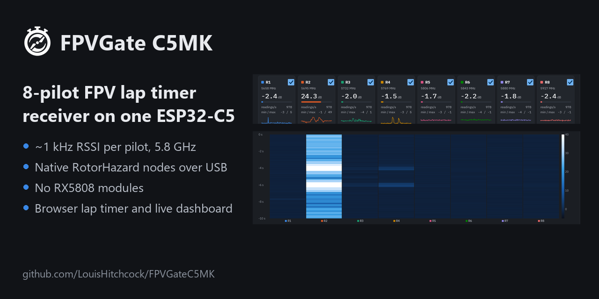
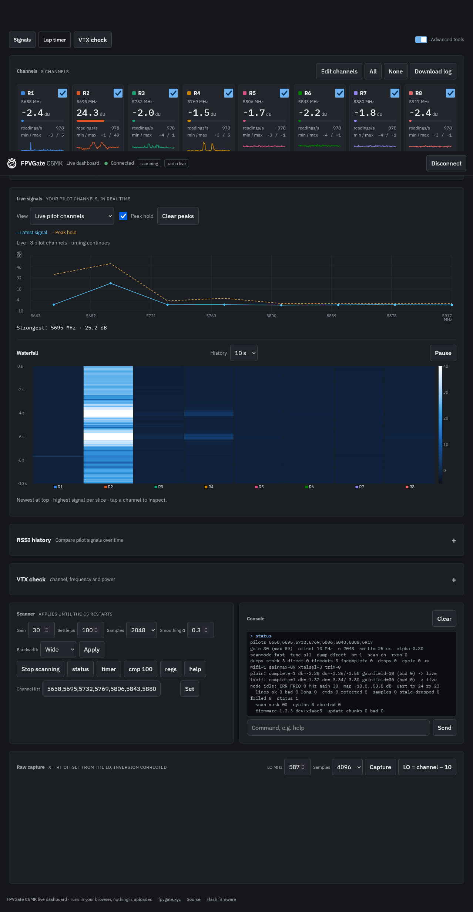
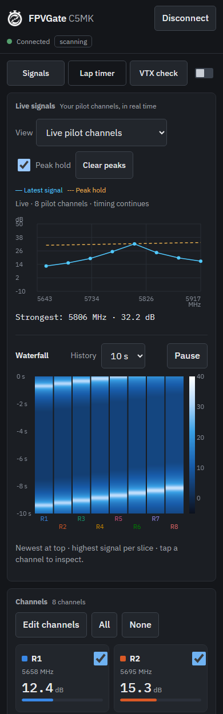
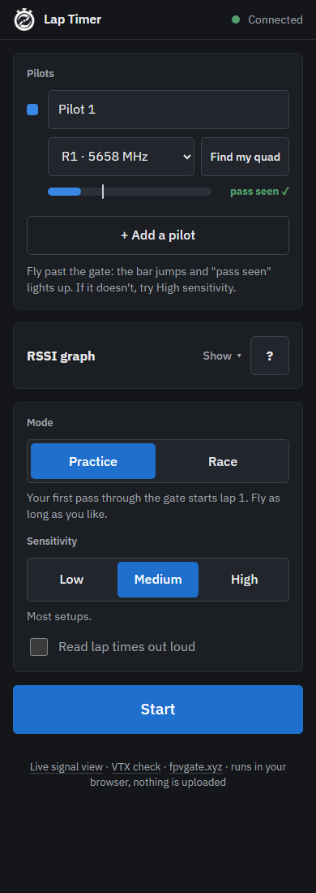
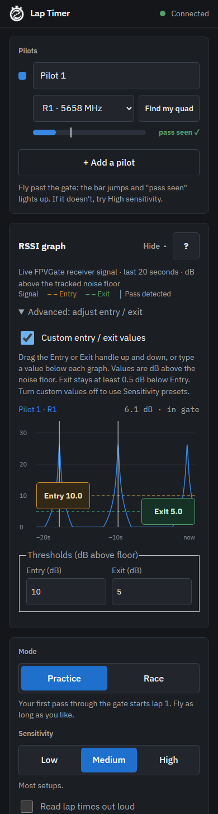
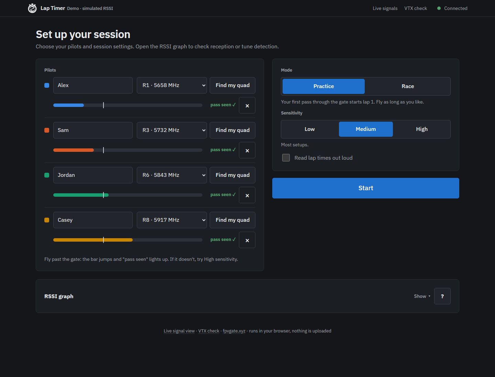
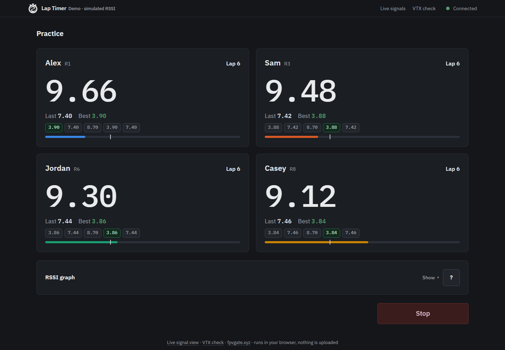
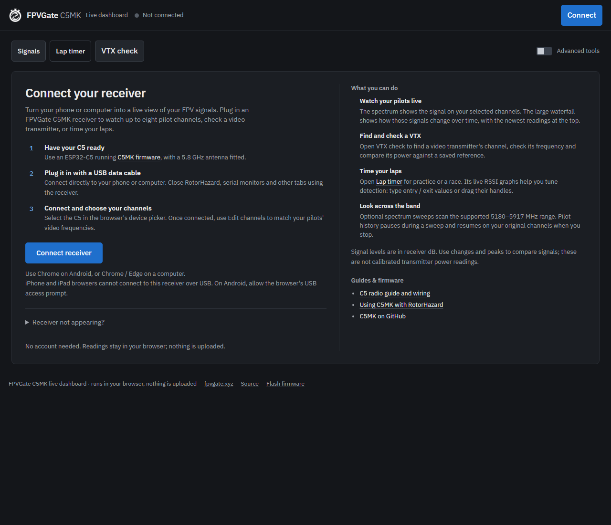

<div align="center">

<picture>
  <source media="(prefers-color-scheme: dark)" srcset="multipilot/web/logo-white.svg">
  
</picture>

# FPVGate C5MK

**An 8-pilot FPV lap timer receiver on one ESP32-C5.**

Open firmware that times up to eight 5.8 GHz drone racing pilots from a single
board. Use it as native RotorHazard nodes over USB, as FPVGate's multi-pilot
receiver, or with the free browser lap timer. No RX5808 modules.

[](https://github.com/LouisHitchcock/FPVGateC5MK/releases/latest)
[](https://github.com/LouisHitchcock/FPVGateC5MK/releases/latest)
[](https://c5mk.fpvgate.xyz)
[](LICENSE)
<br>
[](https://www.espressif.com/en/products/socs/esp32-c5)
[](docs/USB_ROTORHAZARD.md)
[](docs/FPVGate_C5MK_Paper.pdf)
[](https://discord.gg/XwammuWCCj)

**[Try the dashboard](https://c5mk.fpvgate.xyz)** ·
**[Flash firmware](https://fpvgate.xyz/c5.html#flasher)** ·
**[RotorHazard setup](docs/USB_ROTORHAZARD.md)** ·
**[Docs](#documentation)** ·
**[FAQ](#faq)**

<br>



</div>

## Why C5MK

C5MK uses the ESP32-C5's own 5 GHz Wi-Fi radio as a receiver. It hops between
up to eight pilot frequencies and measures each one about 1000 times a second,
so one small board does the job of a stack of RX5808 nodes.

| | |
|---|---|
| **8 pilots, ~1 kHz each** | ~1030 readings per pilot per second, continuous over 60 s runs with no gaps or drops (8 Raceband pilots) |
| **5180–5917 MHz** | Raceband R1–R8 and most other 5.8 GHz bands (Boscam E7 and E8 are out of range) |
| **Band-power RSSI** | Power in a ~10 MHz band around each pilot, computed from raw I/Q, so the reading follows the whole FM signal |
| **Hardware timestamps** | Every reading is stamped by the C5's clock, so USB, UART and host latency don't touch lap times |
| **Native RotorHazard nodes** | Eight seats on one USB port using RH's standard node protocol, with crossing detection on the C5 |
| **Receive only** | The firmware never enables the transmitter, DAC or tone generation |

## Works with

| Timer | Connection | What you get |
|---|---|---|
| **[RotorHazard](https://github.com/RotorHazard/RotorHazard)** | USB | Eight native RH nodes. No node board, ESP32-S3, network or plugin. Sensor Tuning, frequency profiles and race management work as with RX5808 nodes. |
| **[FPVGate](https://github.com/LouisHitchcock/FPVGate)** | UART | The receiver for FPVGate's multi-pilot mode, with over-the-air C5 updates from the gate. |
| **[Browser lap timer](https://c5mk.fpvgate.xyz/timer/)** | USB | 1–4 pilots from a computer or Android phone, with spoken lap times, signal graphs and CSV export. |
| **Your own timer** | UART | A simple documented protocol and a portable C++ host library in [`host/`](host). |

One firmware covers every option: there is no separate USB or UART build.

## Get started

You need an **ESP32-C5 board with a 5 GHz antenna**. The tested boards are the
Waveshare ESP32-C5-Zero (`c5zero`) and the Seeed Studio XIAO ESP32-C5
(`xiaoc5`).

1. **Flash.** Open the [FPVGate web flasher](https://fpvgate.xyz/c5.html#flasher)
   and choose Multi Pilot for your board, or flash the files in
   [`release/<board>/`](release/README.md).
2. **Check.** Open **[c5mk.fpvgate.xyz](https://c5mk.fpvgate.xyz)**, press
   Connect and pick the C5. You should see your channels live.
3. **Race.** Connect it to RotorHazard, FPVGate or the browser timer, as
   below.

The dashboard needs Chrome or Edge on a computer (Web Serial) or Chrome on
Android (WebUSB), and a USB data cable. iPhone and iPad browsers can't connect
over USB. Close RotorHazard, serial monitors and other tabs using the receiver
first: only one program can own the port.

### RotorHazard (USB)

1. Connect the C5's USB port to the computer running RotorHazard with a data
   cable.
2. In RH, open **Advanced Settings > Hardware > Serial Ports**, add the C5's
   port (`COM5` on Windows, `/dev/ttyACM0` or a `/dev/serial/by-id/` path on
   Linux) and restart RH.
3. RH finds eight nodes. Set frequencies, assign pilots, and calibrate
   EnterAt and ExitAt in Sensor Tuning. Readings differ from an RX5808's, so
   calibrate rather than reusing old thresholds.
4. Race as usual: the C5 detects the crossings and RH records and announces
   the laps.

Full guide: [docs/USB_ROTORHAZARD.md](docs/USB_ROTORHAZARD.md).

### FPVGate (UART)

Wire the C5 to FPVGate's ESP32-S3 using the pins the RX5808 used, then set
**Settings > Configuration > Receiver Module** to ESP32-C5. FPVGate's
`docs/C5_MULTI_PILOT.md` is the user guide.

| Host (XIAO ESP32-S3) | `c5zero` | `xiaoc5` |
|---|---|---|
| GPIO4 / D3 (TX) | GPIO4 (RX) | GPIO23 / D4 (RX) |
| GPIO5 / D4 (RX) | GPIO5 (TX) | GPIO24 / D5 (TX) |
| 5V (VUSB) | 5V | 5V (VUSB) |
| GND | GND | GND |

921600 baud, 8N1, 3.3 V logic, no flow control.

> [!IMPORTANT]
> **Power the C5 from 5 V, not from the S3's 3V3 pin.** The C5's radio draws
> a burst of current at start-up that the XIAO S3's regulator can't supply; a
> XIAO ESP32-C5 powered that way never finished booting. See
> [docs/INTEGRATION_GUIDE.md](docs/INTEGRATION_GUIDE.md) section 1.

### Your own timer

[docs/INTEGRATION_GUIDE.md](docs/INTEGRATION_GUIDE.md) covers the C5 side and
[docs/HOST_IMPLEMENTATION.md](docs/HOST_IMPLEMENTATION.md) the receiving side.
[`host/`](host) has a portable C++ library and an ESP32-S3 example. Wiring and
power are as for FPVGate.

## Browser tools

Everything runs locally in your browser: no account, no install, nothing
uploaded.

| Tool | What it does |
|---|---|
| [**Live signals**](https://c5mk.fpvgate.xyz/) | Up to eight pilot channels, a live spectrum with peak hold, a waterfall and RSSI history |
| [**Lap timer**](https://c5mk.fpvgate.xyz/timer/) | Practice or race with 1–4 pilots: noise-floor tracking, sensitivity presets, spoken lap times, CSV results |
| [**VTX check**](https://c5mk.fpvgate.xyz/vtx/) | Find a transmitter's channel, check its centre frequency and compare its power with a saved reference (relative, not calibrated) |
| **Advanced tools** | Receiver settings, console, CSV recording, raw I/Q captures and full-band sweeps of 5180–5917 MHz |



<details>
<summary><b>More screenshots</b> (simulated signals)</summary>
<br>

These use simulated RSSI data and passes to show the interface; they are not
RF measurements.

<p>
  
  
  
</p>







See also the [expanded RSSI graphs](docs/screenshots/timer-rssi-desktop.png)
and [results](docs/screenshots/timer-results-desktop.png).
[docs/screenshots/README.md](docs/screenshots/README.md) explains how to
regenerate them.

</details>

<details>
<summary><b>Lap timer tips</b></summary>
<br>

- Start with **Medium** sensitivity and test a fly-by before racing. Try
  **High** if passes are missed, or **Low** if it triggers too easily.
- The first accepted pass starts the lap clock; later passes record laps.
- The RSSI graph is closed by default. Tap **Show** to open it, or **?** for
  an explanation. Detection keeps running while it's closed.
- To set thresholds by hand, expand **Advanced: adjust entry / exit** during
  setup and type values or drag the handles. Values are dB above each pilot's
  noise floor, with Exit at least 0.5 dB below Entry. These configure the
  browser timer only, not RotorHazard.

</details>

## Updating

Each release has ready-built firmware for both boards in
[`release/<board>/`](release/README.md); see the
[release notes](release/RELEASE_NOTES.md). The first flash over USB writes the
full set (bootloader, partition table, OTA data and firmware).

- **RotorHazard and your own timer:** flash later releases over USB the same
  way.
- **FPVGate** (1.9.0-Multi-Alpha-3 and later) updates the C5 over the existing
  link from **Settings > System > C5 Receiver Firmware**. The C5 rolls back if
  the new firmware can't reach the gate. This needs C5MK 1.1.0 or later; older
  C5s need one USB flash first.

Use 1.2.3 or later for the fast USB signal stream.

<details>
<summary><b>Build from source</b></summary>
<br>

Build and flash with [PlatformIO](https://platformio.org/install/cli) (on
Windows, from PowerShell or cmd rather than Git Bash):

```text
cd multipilot
pio run -e c5zero -t upload --upload-port <port>
```

Check the radio came up:

```text
pip install pyserial
python tools/mp.py --port <port> cmd "status"
```

Look for `wifi=1`, a `gainmax` (89 on chip v1.0) and boot checks ending in
`-> live`. `scanmode fast` is the default; `scanmode full` restores the
original diagnostic scan.

To serve your own copy of the browser tools, run this from the repository
root and open `http://localhost:8000`:

```text
python -m http.server 8000 --directory multipilot/web
```

PC tests are described in [docs/TESTING.md](docs/TESTING.md).

</details>

## FAQ

**Can an ESP32-C5 replace RX5808 modules in a lap timer?**
Yes, for 5180–5917 MHz. One C5 measures up to eight pilots by retuning between
them, about 1000 readings a second each. Boscam E7 and E8 are out of range.

**Does it work with RotorHazard?**
Yes, from 1.2.0. Plug the C5 into the RotorHazard computer over USB and it
appears as eight standard RH nodes. Verified on the Waveshare C5-Zero; XIAO
USB validation is pending. See [docs/USB_ROTORHAZARD.md](docs/USB_ROTORHAZARD.md).

**Which boards are supported?**
The Waveshare ESP32-C5-Zero and Seeed Studio XIAO ESP32-C5 are tested.
Porting to other ESP32-C5 boards with a 5 GHz antenna is covered in
[docs/INTEGRATION_GUIDE.md](docs/INTEGRATION_GUIDE.md).

**Can I time laps with just a phone or laptop?**
Yes, with the [browser lap timer](https://c5mk.fpvgate.xyz/timer/) in Chrome
on a computer or Android phone. Android support is implemented but not yet
tested with a physical phone. iPhone and iPad can't connect over USB.

**How accurate is it?**
Readings are timestamped by the C5's own clock, so connection latency doesn't
affect lap times. Single-quad races through FPVGate work. Lap accuracy against
video hasn't been measured yet, and races with two or more real pilots are
still to be run.

**What are the known limitations?**
Image rejection, brief spikes after a hop, and some untested bands. They are
measured and explained in [docs/RF_RESEARCH.md](docs/RF_RESEARCH.md).

## Documentation

| Document | Contents |
|---|---|
| 📄 [**Technical paper (PDF)**](docs/FPVGate_C5MK_Paper.pdf) | *A Single-Receiver, Software-Defined RSSI Front End for Multi-Pilot FPV Race Timing at 1 kHz per Pilot*: development, methods, results and limitations. Start here. |
| [USB_ROTORHAZARD.md](docs/USB_ROTORHAZARD.md) | Racing with RotorHazard over USB, and how the C5 presents eight RH nodes |
| [INTEGRATION_GUIDE.md](docs/INTEGRATION_GUIDE.md) | Boards, antenna, wiring, flashing, porting, gain and calibration |
| [HOST_IMPLEMENTATION.md](docs/HOST_IMPLEMENTATION.md) | Writing the receiving side: the reference library, protocol, timestamps and lap detection |
| [LINK_PROTOCOL.md](docs/LINK_PROTOCOL.md) | The UART protocol: text lines, binary scan records, clock mapping |
| [ARCHITECTURE.md](docs/ARCHITECTURE.md) | How the receiver and host share the work |
| [SCAN_ENGINE.md](docs/SCAN_ENGINE.md) | The scan loop, timing budget and USB console |
| [RADIO_INTERNALS.md](docs/RADIO_INTERNALS.md) | How the firmware drives the C5's radio: I/Q dump engine, tuning, gain, the meter |
| [RF_RESEARCH.md](docs/RF_RESEARCH.md) | Bench measurements: retune time, passband, image rejection, the path to 1 kHz |
| [FPVGATE_INTEGRATION.md](docs/FPVGATE_INTEGRATION.md) | The FPVGate (ESP32-S3) side, as a reference host |
| [TESTING.md](docs/TESTING.md) | PC tests and hardware checks |
| [LICENSING.md](docs/LICENSING.md), [PROVENANCE.md](docs/PROVENANCE.md) | The licence, and where each technical fact came from |

<details>
<summary><b>Repository layout</b></summary>

```text
multipilot/                 the C5 firmware
  src/                      firmware source (ESP-IDF, C++), including the RotorHazard node endpoint (rh_usb.*)
  test/                     PC tests: meter, framing, link protocol, RH node protocol, host library (no hardware)
  tools/mp.py               USB console, recorder and raw-capture analysis
  tools/capture_web.mjs     reproducible documentation screenshots with simulated receiver data
  web/index.html            responsive live dashboard (desktop Web Serial / Android WebUSB)
  web/timer/                browser lap timer with optional RSSI graph and touch threshold tuning
  web/vtx/                  standalone VTX channel, frequency and relative power check
host/                       the receiving side, for your own timer
  c5host/                   portable C++ library for the UART link and gate passes
  examples/esp32s3/         minimal ESP32-S3 host (PlatformIO, Arduino)
docs/                       documentation and browser screenshots
release/<board>/            ready-built firmware for the current release
```

</details>

## Acknowledgements

Thanks to [C5VRX](https://github.com/Twotoz/C5VRX) (Twotoz and contributors)
for the initial discovery that the ESP32-C5 can receive analog FPV video, and
for pointing this project in the right direction, and to
[ESP-SDR](https://github.com/ESPARGOS/esp-sdr) (ESPARGOS), who first published
that ESP32 radios have a raw I/Q capture path. C5MK contains no code from
either project; see [docs/PROVENANCE.md](docs/PROVENANCE.md).

Thanks to [RaceFPV](https://github.com/RaceFPV) for finding that rewriting the
gain force on every hop disturbs the receiver, the fix behind 1.2.1's steadier
readings, and for pinning the build platform
([#1](https://github.com/LouisHitchcock/FPVGateC5MK/pull/1)).

## Licence

CC BY-NC-SA 4.0 for non-commercial use, the same as FPVGate. Commercial use
(selling hardware or kits running this firmware, or a paid service) needs a
separate commercial licence. See [LICENSE](LICENSE) and
[docs/LICENSING.md](docs/LICENSING.md).
